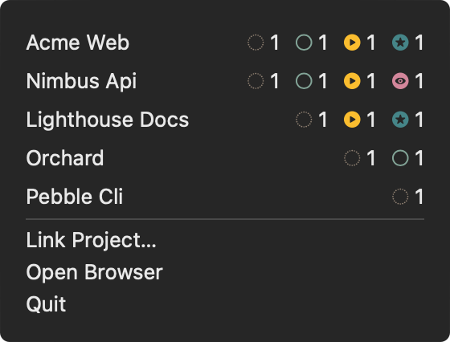
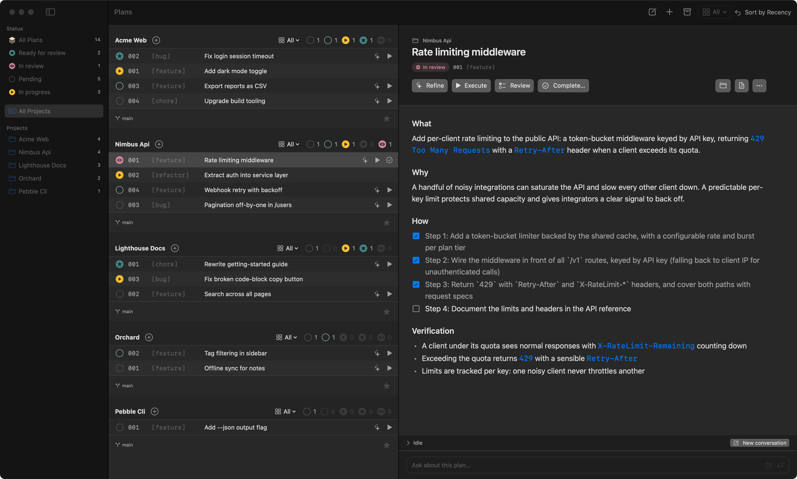

# Plans

[](https://www.apple.com/macos/)
[](https://swift.org)

**Plans is a native macOS app that shows your [plans-cc](https://github.com/mattfordham/plans-cc) tasks across *every* project on your machine, at a glance.** plans-cc stores tasks as markdown files in a `.plans/` directory at the root of each project, so if you work across many repos there's normally no single place to see what's in flight everywhere — you have to `cd` into each one. Plans fixes that with two always-available surfaces: a menu-bar glance and a cross-project browser window.

## Contents

**Get started**
- [Two surfaces](#two-surfaces)
- [Requirements](#requirements)
- [Build & install](#build--install)

**Reference**
- [How it works](#how-it-works)
- [Project layout](#project-layout)

## Two surfaces

- **Menu bar glance** — a menu bar item showing, per project, a compact
  breakdown of task counts by status. The 20,000-foot view of what's hot right
  now, everywhere, without opening a window.
- **Browser window** — a cross-project task browser: pick a status view or a
  project in the sidebar, then select a plan to see its body, checklist, and an
  agent dock for running and discussing it, all in the same window.





## Requirements

- macOS 15 or later
- Swift 6.0 toolchain (Xcode 16+) to build from source

## Build & install

Clone the repo, then:

```bash
# Build and launch from the repo (binary symlinked; for local dev)
./build.sh

# Build and install Plans.app into /Applications (self-contained copy)
./install.sh
```

Install elsewhere with `DEST_DIR=~/Applications ./install.sh`.

Or use Swift Package Manager directly:

```bash
swift build -c release    # produces .build/release/Plans
swift test                # run the test suite
```

## How it works

Plans reads two data contracts produced by plans-cc:

1. **The registry** — the list of project roots you've registered.
2. **The task-file format** — the markdown task files under each project's
   `.plans/` directory.

It polls these on a short interval so both surfaces stay live as you work. See
[`desktop-app-spec.md`](desktop-app-spec.md) for the full specification and the
exact data contracts.

## Project layout

```
Sources/Plans/   # SwiftUI app source (views, store, parsers)
Tests/PlansTests/ # XCTest unit tests
Resources/       # Info.plist, app icon
Tools/           # Icon generation helper
build.sh         # Build + assemble + launch Plans.app
install.sh       # Build + install Plans.app into /Applications
```

Built with SwiftUI and Swift Package Manager — no external dependencies.
